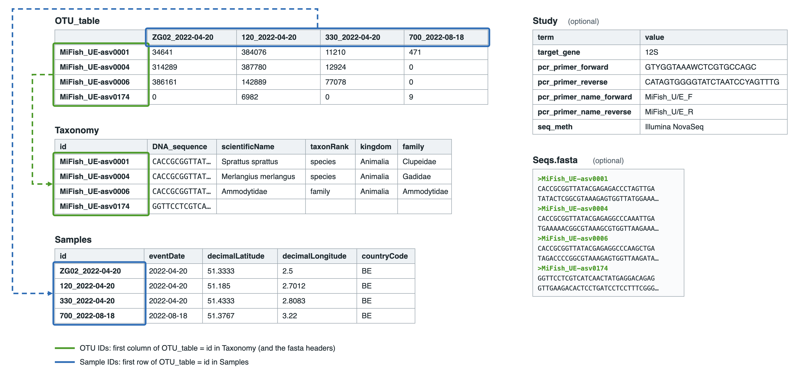

[[file_rules]]
=== File rules and templates

Your data goes into the MDT as three tables – *OTU_table*, *Taxonomy* and *Samples* – plus two optional files: a *Study* table and a fasta file. The MDT links the tables by their IDs.

.The OTU table holds the read count of each OTU in each sample. OTU IDs link it to the Taxonomy table, and sample IDs to the Samples table.

[IMPORTANT]
====
*IDs must match across the tables.*

* Sample IDs: the column headers of the *OTU_table* must match the `id` column of the *Samples* table.
* OTU IDs: the first column of the *OTU_table* must match the `id` column of the *Taxonomy* table (and the headers in the fasta file).

A sample or OTU that is missing from one of the tables is left out of the published dataset. You can use this on purpose to remove control samples or contaminants (see <<before_you_start>>).
====

[[fit_data]]
==== File formats

Upload either:

* *one Excel workbook* (.xlsx) with the sheets *OTU_table*, *Taxonomy*, *Samples* and, optionally, *Study*, or
* *separate text files* (.tsv, .csv or .txt), one per table, named *OTU_table*, *Taxonomy*, *Samples* and, optionally, *Study*.

You can add a fasta file (.fasta, .fa or .fas) to either, and you can put all files in one .zip file. For BIOM and FAIRe files, see <<other_formats>>.

Capital letters, spaces and underscores in sheet and file names do not matter. Text files can be separated by tabs, commas or semicolons. The order of rows and columns does not matter.

TIP: Use Darwin Core terms as column names where you can (see <<req_recom>>). The MDT then maps them automatically.

[[other_formats]]
==== BIOM and FAIRe files

The MDT also accepts two other formats.

*BIOM:* upload a BIOM file of version 2.1 (the HDF5 format, for example exported from QIIME 2; .biom, .h5, .hdf5 or .he5) in place of the OTU table, together with a *Samples* table and a *Taxonomy* table as text files. In the Taxonomy table, the ID column can also be named `feature id`, as in QIIME 2. BIOM version 1.0 files cannot be processed.

*FAIRe:* upload data in the https://fair-edna.github.io/[FAIRe (FAIR eDNA)] format, as one Excel workbook or as separate text files. The MDT needs the parts *sampleMetadata*, *experimentRunMetadata*, *otuFinal* and *taxaFinal*. If *projectMetadata* is included, the MDT uses it to fill in the dataset metadata. If the data contains several assays (markers), choose one after upload: the MDT processes one assay per dataset.

==== The OTU_table

* One row per OTU or ASV and one column per sample. The MDT also accepts the transposed table (samples as rows, OTUs as columns), but this is not fully tested.
* First column: the OTU IDs. First row: the sample IDs. Leave the top-left cell empty (the MDT ignores it).
* The cells hold read counts only. For no reads, use 0 or leave the cell empty: the MDT reads empty cells as 0. Cells with text, such as `NA`, are also read as 0, so check that all counts are numbers.
* Remove everything else: totals, taxonomy and sample information go in their own tables.
* Each OTU ID and sample ID must be unique. Sample IDs become the term:dwc[eventID] of each sample.

[[tax_form]]
==== The Taxonomy table

* One row per OTU. Name the first column `id` and fill it with the OTU IDs.
* Add the DNA sequence of each OTU in a term:mixs[DNA_sequence] column, unless you provide a fasta file.
* Add the name and classification of each OTU, as detailed as you can. See <<table-02>>.
* With text files, you can leave out the Taxonomy table if you give the sequences in a fasta file and have no taxonomy. The OTUs then have no names, unless you tick *Assign taxonomy* in step 3.

==== The Samples table

* One row per sample. Name the first column `id` and fill it with the sample IDs.
* Add information about each sample, such as country, location and date. See <<table-01>>.

==== The Study table (optional)

Use it for values that are the same for the whole dataset, such as the target gene and primers. See <<table-03>>.

TIP: Instead of a Study table, you can enter the same terms and values in step 2 (see <<map_defaults>>).

Put each field in one table only. If a term is in the Study table and is also a column in the Samples or Taxonomy table, the MDT uses the Study value. If a column is in both the Samples and the Taxonomy table, it uses the Samples value.

The Study table has two columns, `term` and `value`. These are four rows from the Study table of the example dataset (see <<example_data>>):

[cols="2,3",options="header",width=80%]
|===
| term | value
| countryCode | BE
| target_gene | 12S
| pcr_primer_forward | GTYGGTAAAWCTCGTGCCAGC
| seq_meth | Illumina NovaSeq
|===

IMPORTANT: Spell the terms exactly as in the term lists (see <<all_terms>>). Misspelled terms in the Study table cannot be fixed in the mapping step. Either correct the spelling and upload again, or add the term with its value in step 2 instead (see <<map_defaults>>).

==== The fasta file (optional)

You can supply a fasta file instead of having the sequences in the Taxonomy table. Each header line is ">" followed by an OTU ID from the *OTU_table*:

[source]
----
>MiFish_UE-asv0001
CACCGCGGTTATACGAGAGACCCTAGTTGATATACTCGGCGTAAAGAGTGGTTATGGAAA
ACAAGCACTAAAGCCAAAGAGCCCTCAGGCCGTTATACGCACCCGGGGCCTCGAGCCACT
ATCACGAAAGTAGCTTTACCCTCGCCCACCAGAACCCACGAGAGCTGGGACA
>MiFish_UE-asv0004
CACCGCGGTTATACGAGAGGCCCAAATTGATGAAAAACGGCGTAAAGCGTGGTTAAGAAA
ATAAGAGAAAATATGGCCGAACAACTTCAAAGCAGTTATACGCATCCGAAGTCACGAAGA
ACAATCACGAAAGTTGCCCTAAAGCCTCCGATTCCACGAAAGCCATAAAA
----

[[templates]]
==== Templates

The templates contain the Required and Strongly recommended columns (see <<req_recom>>). You can add any other Darwin Core or DNA term as an extra column (see <<all_terms>>). Pick the template that fits your data.

[cols="2,3,2",options="header"]
|===
| Template | Format | Download
| [[template1]]1. Excel | One workbook with all tables as sheets | link:../templates/otutable_template1_excel.current.en.xlsx[English], link:../templates/otutable_template1_excel.current.es.xlsx[Spanish]
| 2. Excel + fasta | Workbook, with sequences in a fasta file | link:../templates/otutable_template2_excel_w_fasta.current.en.zip[Template 2]
| 3. Text files | One tab-separated file per table | link:../templates/otutable_template3_tsv_files.current.en.zip[Template 3]
| 4. Text files + fasta | Text files, with sequences in a fasta file | link:../templates/otutable_template4_tsv_files_w_fasta.current.en.zip[Template 4]
|===

[[example_data]]
==== Example dataset

The example is 12S (MiFish) eDNA from 157 seawater samples taken at nine stations off the Belgian coast in 2021–2023. It comes in two versions:

[cols="2,3,1",options="header"]
|===
| Version | Use it for | Download
| [[example1]]*Practice version* | Practising (<<simple_quick_start>>). A few columns need mapping in step 2, as shown in <<map_example>>. | link:../example_data/example_data_12S.current.en.xlsx[Excel]
| [[example2]]*Complete version* | A model for your own data: every column has its Darwin Core name. | link:../example_data/example_data_12S_complete.current.en.xlsx[Excel]
|===

The example is modified from a published dataset (licence CC BY 4.0):

[quote]
Flanders Research Institute for Agriculture, Fisheries and Food (ILVO): 12S eDNA from seawater samples collected within the coastal zone of the Belgian part of the North Sea. https://doi.org/10.15468/kg56dz accessed via GBIF.org on 2026-09-30.

Sample IDs and taxonomy were cleaned up, and the links to the sequence archive point to made-up accession numbers. The columns salinity, recordedBy and coordinateUncertaintyInMeters were added for illustration and are not real data. Compare the example with the published dataset, including its description.

TIP: You can download the files of any dataset published through the MDT, and construct upload files to use as examples. See <<extract_examples>>.
