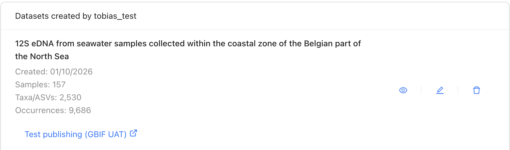

[[detailed_guidance]]
== Process your data in the MDT

The MDT takes you through seven steps, shown in the bar at the top of the screen: *Upload*, *Map*, *Process*, *Review*, *Metadata*, *Export* and *Publish*. This chapter describes steps 1–6; publishing is described in <<publish_update>>.

.The step bar

[[detailed_landing]]
=== Your datasets

Click *My datasets* at the top of the page to see the datasets you have uploaded. For each dataset you can:

* view it (eye icon): its data, its metadata and, under *Files available*, the files the MDT has made, such as the Darwin Core Archive, the BIOM files and a processing log,
* edit it (pen icon), which opens it at step 1, from where you can go to any step,
* delete it (trash icon).

Before you edit or delete a dataset that is already published, read <<update>>.

.*My datasets*

For help, click *Need help?* on the home page to email the administrator of your MDT installation. To report a problem with the MDT itself, click *Report a bug* at the bottom of any page.
