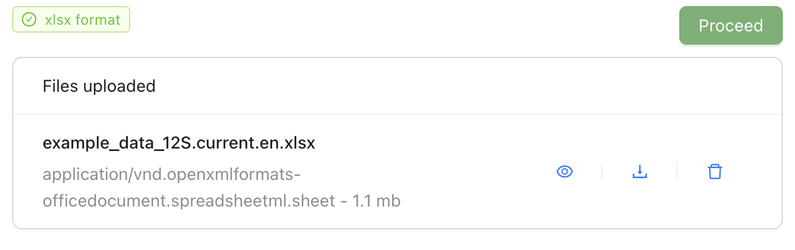

[[upload]]
=== Step 1: Upload your data

Upload your prepared files (see <<file_rules>>). The MDT checks the file types and whether the IDs match across the tables.

. Click *New dataset* at the top of the page.
. Drag your files to the upload area, or click it to select them.
. Enter a name under *Dataset title or nickname*. You can change it in step 5.
. Click *Start Upload*.
. Under *Files uploaded*, check that your files are listed. An Excel file gets the tag *xlsx format*. If you uploaded text files, check that each was recognised as the right table; if not, choose the right one under *Select entity type*.
. Optional: click the eye icon to look at your tables.
. Click *Proceed*.

.An uploaded Excel file, ready for the next step

==== Warnings you may see

[cols="3,2",options="header"]
|===
| Message | What to do

| "Invalid format"
| The MDT did not recognise the files. Check the file types and names: see <<fit_data>>.

| "Unsupported file format. Text files (tsv, csv, fasta etc), BIOM and Excel files are supported. Please check the guide for more information."
| Save your data as .xlsx, .tsv, .csv or .txt, as a fasta file or as a BIOM file.

| "Could not identify the data type. Is it OTU table, Taxonomy table, Sample table or Study defaults?"
| Choose the table type under *Select entity type*, or rename the file (see <<fit_data>>).

| "Attention: … of … sample IDs in the OTU table has no matching row in the Sample table. Non-matching IDs will be excluded from the final dataset." (and similar messages)
| Some IDs differ between the tables. If you left them out on purpose, for example control samples, continue. Otherwise see <<file_rules>>.

| "The column … is present in both the sample and taxon file. Only the value from the sample file will be added to the DWC archive." (and similar messages about the study file)
| The same field is in two tables. If the value the MDT keeps is the right one, continue. Otherwise remove the field from one table and upload again (see <<file_rules>>).

| "No id column found in file … Using column "…" instead. This can be changed in the mapping step."
| Name the ID column `id` and upload again, or choose the right column in step 2.

| "The target_gene value "…" has been recorded as "…", the GBIF vocabulary term for "…"."
| Nothing: the MDT has replaced your marker name, for example 12S, with the matching term from GBIF's target_gene vocabulary.

| "The target_gene value "16S" does not say which 16S region was targeted. …"
| The MDT has recorded it as prokaryotic 16S. If you sequenced mitochondrial or plastid 16S, choose the right term for target_gene in step 2.

| "The target_gene value "…" is not in the GBIF target_gene vocabulary. …"
| Choose the marker for target_gene from the list in step 2. Otherwise the marker cannot be interpreted and *Assign taxonomy* cannot be used.

| "This dataset contains multiple assays: … MDT can only process one assay at a time. Processing assay '…' only."
| FAIRe data only: choose the assay you want under *Select Assay*. Publish each assay as a separate dataset.
|===

Next: <<map_terms>>.
