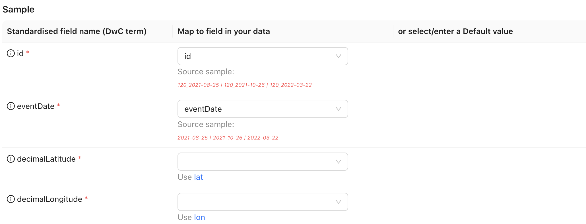
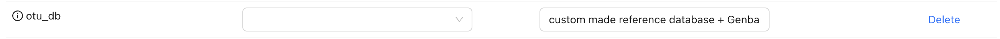
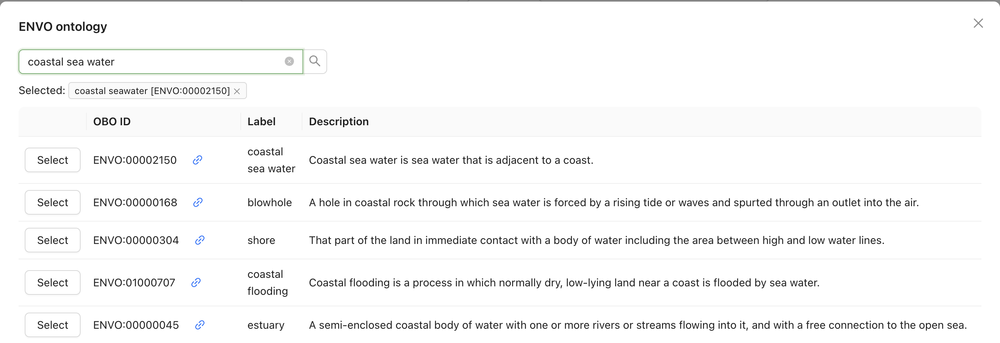
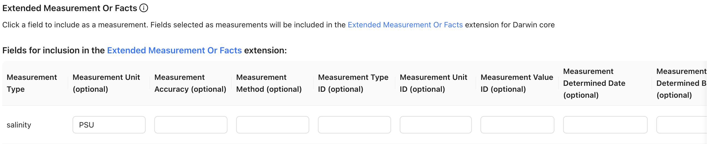
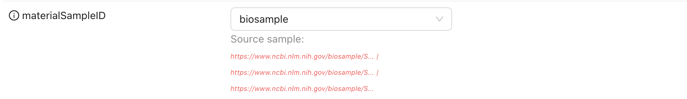

[[map_terms]]
=== Step 2: Map your columns to Darwin Core

GBIF needs your data described with standard field names (Darwin Core terms). In this step you link each column in your tables to the right term. Columns that already have Darwin Core names are mapped automatically; you check them and map the rest.

The page has a *Sample* section, a *Taxon* section and a list of *Unmapped fields*. Click *How to use this* for a guided tour.

. Check the automatic mappings under *Sample* and *Taxon*.
. If the MDT suggests a column for a term, click the suggestion to accept it. Suggestions are made for common column names such as `lat`, `latitude`, `date`, `sequence`, `sample_name` and `marker`.
. Map the remaining columns. If the term already has a row, choose your column under *Map to field in your data*. If not, search for the term in *Add mapping for another sample field* (or *Add mapping for another Taxon/ASV field*) under *Sample* or *Taxon*, click *Add field*, then choose your column.
. Click *Save mapping* now and then, so that you do not lose your work.
. When all columns you want to publish are mapped, click *Proceed*.

.The Sample section: Darwin Core terms on the left, your columns in the middle, dataset-wide values on the right

TIP: Every term from the Darwin Core Occurrence and Event cores and the DNA derived data extension can be added. See <<req_recom>> for the most important ones and <<all_terms>> for the full lists.

[[map_defaults]]
==== Add values that apply to the whole dataset

For values that are the same for all samples, such as the target gene or the primers, you do not need a column:

. Add the term with *Add mapping for another sample field* and *Add field*.
. Enter the value under *or select/enter a Default value*. For target_gene, choose the marker from the list of GBIF vocabulary terms. Type a short form, such as 12S, COI or rbcL, to find it.

This has the same effect as the *Study* table (see <<file_rules>>).

.A default value: otu_db has no column, but one value for the whole dataset

==== Describe the environment with ENVO terms

For term:mixs[env_broad_scale], term:mixs[env_local_scale] and term:mixs[env_medium], use terms from the Environment Ontology (ENVO). The three fields describe the sample from large to small:

* *env_broad_scale:* the biome the sample comes from.
* *env_local_scale:* the local feature at the sampling site.
* *env_medium:* the material the DNA was taken from.

.Examples of ENVO terms for common sample types
[cols="2,3,3,3",options="header"]
|===
| Sample | env_broad_scale | env_local_scale | env_medium
| Sea water | marine biome [ENVO:00000447] | neritic pelagic zone biome [ENVO:01000032] | coastal sea water [ENVO:00002150]
| Lake water | freshwater lake biome [ENVO:01000252] | lake [ENVO:00000020] | lake water [ENVO:04000007]
| River water | freshwater river biome [ENVO:01000253] | river [ENVO:00000022] | river water [ENVO:01000599]
| Estuarine sediment | estuarine biome [ENVO:01000020] | estuary [ENVO:00000045] | sediment [ENVO:00002007]
| Forest soil | temperate woodland biome [ENVO:01000221] | temperate broadleaf forest [ENVO:01001794] | forest soil [ENVO:00002261]
| Field soil | cropland biome [ENVO:01000245] | agricultural field [ENVO:00000114] | agricultural soil [ENVO:00002259]
| Moss | tundra biome [ENVO:01000180] | area of moss-dominated vegetation [ENVO:01000890] | plant matter [ENVO:01001121]
| Rock surface (swab) | terrestrial biome [ENVO:00000446] | rock [ENVO:00001995] | biofilm [ENVO:00002034]
| Indoor dust | anthropogenic terrestrial biome [ENVO:01000219] | building [ENVO:00000073] | dust [ENVO:00002008]
|===

Choose the most specific term that fits your samples. If the values differ between samples, put them as columns in the Samples table.

To pick a term in the MDT:

. Click *Browse ENVO ontology*, or the pencil icon if the field already has a value.
. Search for a term under *Search the ontology*, for example "coastal sea water".
. Click *Select* next to the term, then *OK*.

.Searching the ENVO ontology

==== Add measurements that have no Darwin Core term

Some columns, such as salinity, have no matching Darwin Core term. You can publish them as measurements:

. Under *Extended Measurement Or Facts*, click the column.
. Fill in the details, such as *Measurement Unit (optional)*.

.A column added as a measurement, with its unit

NOTE: Columns you leave unmapped are left out of the Darwin Core Archive, so GBIF.org does not show them as data. They are kept in the MDT and in the dataset's BIOM files, and you can map them later by editing the dataset.

[[map_example]]
==== Example: the practice dataset

In the practice dataset (see <<example_data>>), four things need your attention in this step:

. *Accept a suggestion:* for decimalLatitude and decimalLongitude, the MDT suggests the columns `lat` and `lon`. Click each suggestion.
. *Map a column yourself:* under *Sample*, the materialSampleID row is already there but empty. Choose `biosample` under *Map to field in your data*.
. *Enter a default value:* the Study table has no value for countryCode. Under *Sample*, search for countryCode in *Add mapping for another sample field*, click *Add field*, and enter `BE` under *or select/enter a Default value*.
. *Add a measurement:* under *Extended Measurement Or Facts*, click `salinity` and enter `PSU` under *Measurement Unit (optional)*.

Then click *Save mapping* and *Proceed*.

.materialSampleID mapped to the column biosample

==== Warnings you may see

[cols="3,2",options="header"]
|===
| Message | What to do

| "You have no fields named 'decimalLatitude' and 'decimalLongitude' and you have not provided mappings for those fields."
| Map your latitude and longitude columns (decimal degrees). Without them, your records have no location.

| "You have no field named 'eventDate' and you have not provided a mapping for that field."
| Map your date column, or enter the date as a default value. Use the format YYYY-MM-DD.

| "You have no field named 'DNA_sequence' and you have not provided a mapping for that field."
| Map the column with the sequences, or upload the sequences as a fasta file.

| "You have no 'id' field in your sample file …" (or "… in your taxon file …")
| Choose the column with the sample IDs (or OTU IDs) for the term *id*.

| "Waiting for validation to finish" or "The field names of your files are not available"
| The MDT is still checking your upload, or could not read it. Wait a moment and click *Check again*. If that does not help, click *Back to upload* and check that each file was recognised.

| "Ouch - Something went wrong, the mapping was not saved"
| Click *Save mapping* again. If it keeps failing, log out and in again.

| A term from your *Study* table is not mapped
| The term is probably misspelled. Correct it and upload again, or add the term here with a default value.
|===

Next: <<process_data>>.
