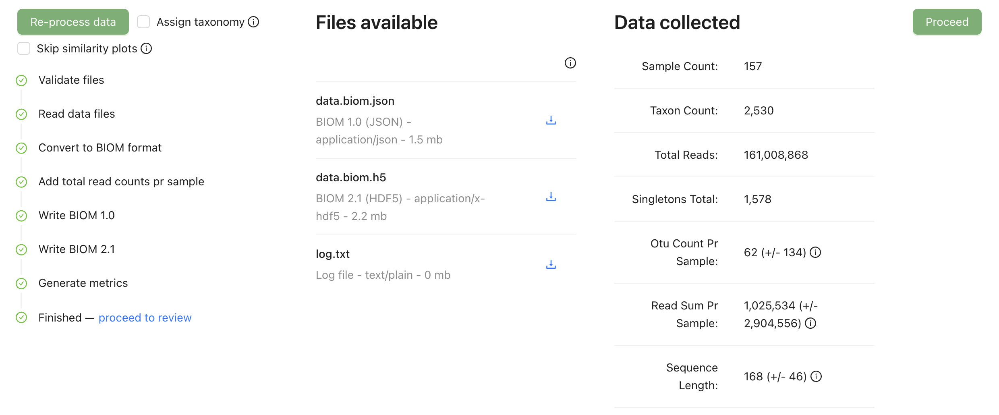

[[process_data]]
=== Step 3: Process your data

The MDT combines your tables into one dataset, checks again that the IDs match, and calculates some statistics.

. Optional: tick *Assign taxonomy* to let the MDT name your OTUs. This replaces all taxonomy in your uploaded data, so leave it unticked if you have already assigned taxonomy. It needs a default value for target_gene (see below).
. Optional: for large datasets, tick *Skip similarity plots*. Processing is then much faster, but step 4 shows no ordination plots.
. Click *Process data*. Each part gets a green tick when it is done.
. Check that the numbers of samples and OTUs under *Data collected* are what you expect.
. Click *Proceed*.

To run the processing again, for example after changing the mapping, click *Re-process data*.

.Processing finished: every part has a green tick

==== Assign taxonomy (optional)

*Assign taxonomy* compares each sequence with a reference database, using the https://www.gbif.org/tools/sequence-id[GBIF Sequence ID tool^].

The option can only be ticked when term:mixs[target_gene] has a default value for one of these markers, set in step 2 or in the Study table. Each marker is compared with its own reference database:

[cols="2,3,2",options="header",width=80%]
|===
| Marker | target_gene vocabulary term | Reference database
| COI | COI | BOLD
| ITS | ITS_region | UNITE
| ITS1, ITS2 | ITS1, ITS2 | UNITE
| 16S (prokaryotic) | SSU_rRNA_16S_prokaryotic | GTDB
| 12S | SSU_rRNA_12S_mitochondrial | MitoFish
| 18S | SSU_rRNA_18S_eukaryotic | PR2
|===

To see which version of the database is used, hold the mouse over *Assign taxonomy*. The matching works like this:

* 99% identity or more: exact match. The scientific name is filled in.
* 90–99% identity: close match. Ranks down to genus are filled in.
* Only matches that cover more than 80% of the sequence are used.

IMPORTANT: *Assign taxonomy* replaces any taxonomy in your uploaded data. It is also slow for large datasets, so it is often better to assign taxonomy yourself before upload.

==== Warnings you may see

[cols="3,2",options="header"]
|===
| Message | What to do

| "<sample IDs> in the OTU table are not present in the SAMPLE table", for example "ZG02_2022-04-20, 120_2022-04-20 in the OTU table are not present in the SAMPLE table". Similar messages say "… in the SAMPLE table are not present in the OTU table", "… in the OTU table are not present in the TAXONOMY" and "… in the TAXONOMY are not present in the OTU table". Long lists end with "and … more ids".
| Some IDs differ between the tables. If you left them out on purpose, continue. Otherwise see <<file_rules>>.

| "… - Failed: This data matrix has out of bounds value - Check that column names in the OTU table corresponds to the IDs in the sample file."
| The sample IDs in the OTU table do not match the `id` column of the Samples table. Correct your files and upload again (see <<file_rules>>).

| "There is no 'id' column in the sample file and no other column has been marked as the identifier ('id')" (or "… in the taxon file …")
| Go back to step 2 and choose the ID column for the term *id*.
|===

Next: <<review>>.
