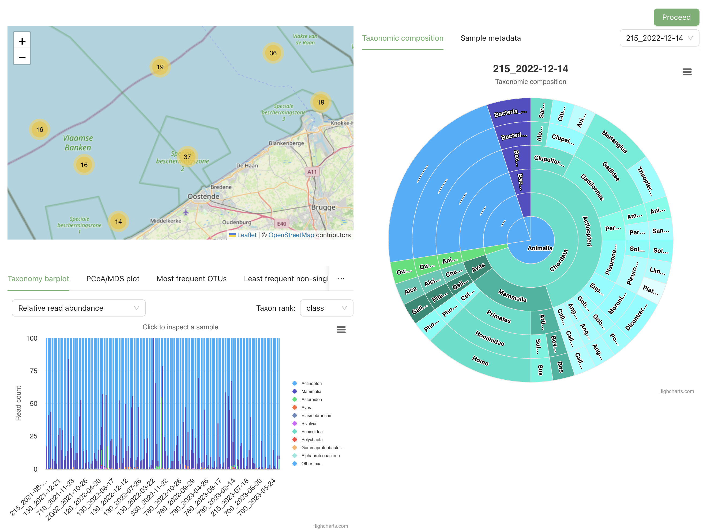

[[review]]
=== Step 4: Review your data

Check that the processed data looks as you expect before you describe and publish it.

. Go through the checks in the table below.
. If something is wrong, correct your files and upload them again in step 1.
. Click *Proceed*.

.The review page with one sample selected

[cols="2,3,3",options="header"]
|===
| Check | What to look for | If it looks wrong

| Map
| The samples are where you took them.
| Latitude and longitude must be in decimal degrees. Check that they are not swapped and that the minus signs are right.

| *Taxonomy barplot*
| The groups you expect. Try other views, such as *Relative read abundance* or another *Taxon rank:*.
| Check your taxonomy. Remove contaminants (see <<before_you_start>>).

| *PCoA/MDS plot*
| Samples that lie far from all others. Try another option under *Color by:* or *Choose distance metric:*.
| An outlier is often a control or failed sample. Remove it from the Samples table and upload again.

| Single samples: click a sample in a chart or on the map, or choose it in the list on the right
| Its *Taxonomic composition* and *Sample metadata* are correct.
| Check the mapping in step 2.

| *Most frequent OTUs* and *Least frequent non-singleton OTUs*
| The names are plausible.
| Check your taxonomy.
|===

==== Messages you may see

[cols="3,2",options="header"]
|===
| Message | What it means

| "The ordination plots were not generated for this dataset"
| You ticked *Skip similarity plots* in step 3. Nothing to fix.

| "This dataset is too large for the taxonomy chart to be generated"
| Normal for very large datasets. Nothing to fix.
|===

Next: <<add_metadata>>.
