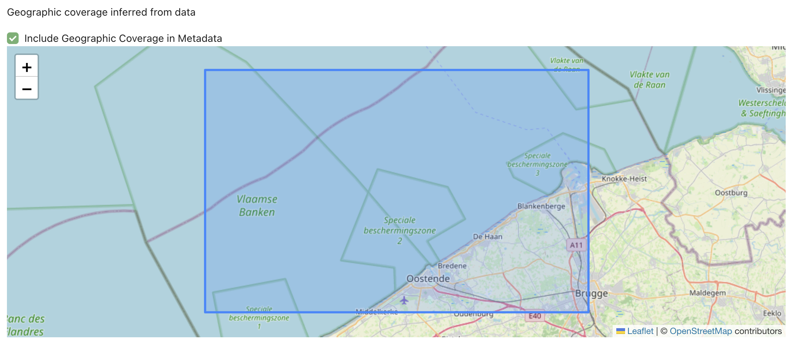
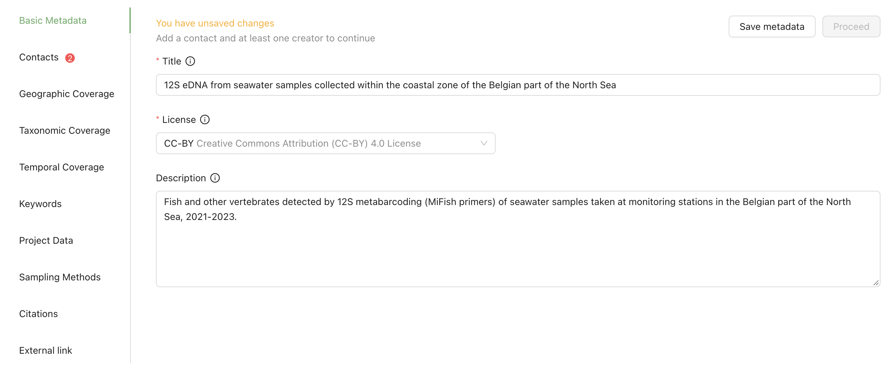

[[add_metadata]]
=== Step 5: Add metadata

Describe your dataset: title, people, licence, description and methods. See <<prepare_metadata>> for what to write.

Take your time here. The metadata is what others read to judge whether your data is fit for their purpose before they reuse it: how the samples were taken, how the DNA was processed and how the taxonomy was assigned. The richer the description, the more useful your data is.

. Go through the tabs, starting with *Basic Metadata* and *Contacts*.
. Fill in at least the title, the licence, a contact with an email address and one creator. Until you have, the form shows "Add … to continue", and a badge marks the tabs with missing information.
. Click the ⓘ icon next to a field name for a tip.
. If the contact is also a creator, click *Copy to creator* next to the contact.
. To add many people at once, click *Upload Creator list* (or the list for another role) and choose a filled-in people template. The template can be downloaded next to the button.
. Check the *Geographic Coverage*, *Taxonomic Coverage* and *Temporal Coverage* tabs. The MDT fills them in from your data, but includes them only if you tick *Include Geographic Coverage in Metadata* (and the same box on the other two tabs).
+
.Geographic coverage worked out from the sample coordinates

. Click *Save metadata*, then *Proceed*.

.The metadata form, with its tabs on the left

==== Warnings you may see

[cols="3,2",options="header"]
|===
| Message | What to do

| "Please input dataset title"
| Enter a title on the *Basic Metadata* tab.

| "Please select a license"
| Choose a licence on the *Basic Metadata* tab.

| "You must enter a contact person for the dataset"
| Add a contact, with an email address, on the *Contacts* tab.

| "You must enter at least one creator of the dataset"
| Add a creator on the *Contacts* tab.

| "Please input a valid orcid (XXXX-XXXX-XXXX-XXXX)"
| Enter the ORCID without the web address, for example 0000-0002-1825-0097.

| "You have unsaved changes"
| Click *Save metadata* before you leave the page.
|===

Next: <<export>>.
