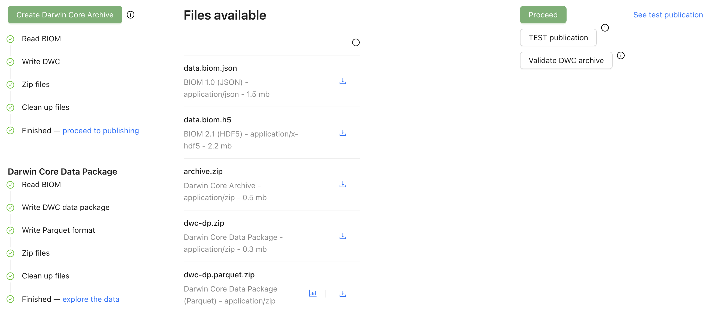
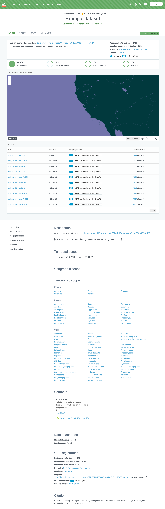

[[export]]
=== Step 6: Create the Darwin Core Archive

The MDT turns your data and metadata into a <<dwc-a,Darwin Core Archive>>, the file format that GBIF publishes. Before you publish, you can preview your dataset in GBIF's test environment and have it checked by the GBIF data validator.

. Click *Create Darwin Core Archive*. Each part gets a green tick when it is done.
. Recommended: click *TEST publication* to publish the dataset in GBIF's test environment, where nobody else will use it.
. Click *See test publication* and check the dataset page as a user would: title, description, people, map, taxa and number of occurrences.
. Optional: click *Validate DWC archive*. You receive an email when the check is finished; then click *Validation report*.
. If something is wrong, correct it in the step where it belongs and create the archive again.
. Click *Proceed*.

.The archive is created and the dataset is published in the test environment

NOTE: Processing in the test environment takes from 15 minutes to an hour. Until it is finished, the dataset page may show 0 occurrences and no map.

The MDT also creates a *Darwin Core Data Package* (DwC-DP), a newer format that GBIF is introducing. You do not need to do anything with it; to try it, click *explore the data*.

.Your dataset in GBIF's test environment, marked TEST

==== Warnings you may see

[cols="3,2",options="header"]
|===
| Message or problem | What to do

| "The metadata is not complete. A Darwin Core Archive cannot be created until the metadata has been filled in. Missing: …"
| Click *Go to metadata* and add what is missing (see <<add_metadata>>).

| You are logged out when you click *Create Darwin Core Archive*
| This has happened in Google Chrome. Reinstalling Chrome solved it; you can also try another browser.
|===

Next: <<publishing>>.
