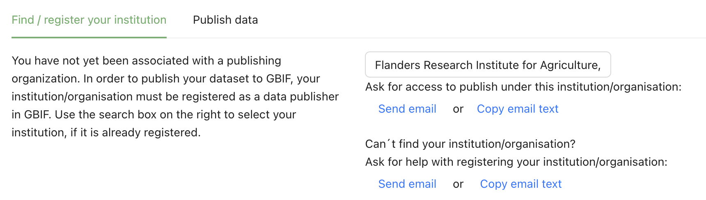
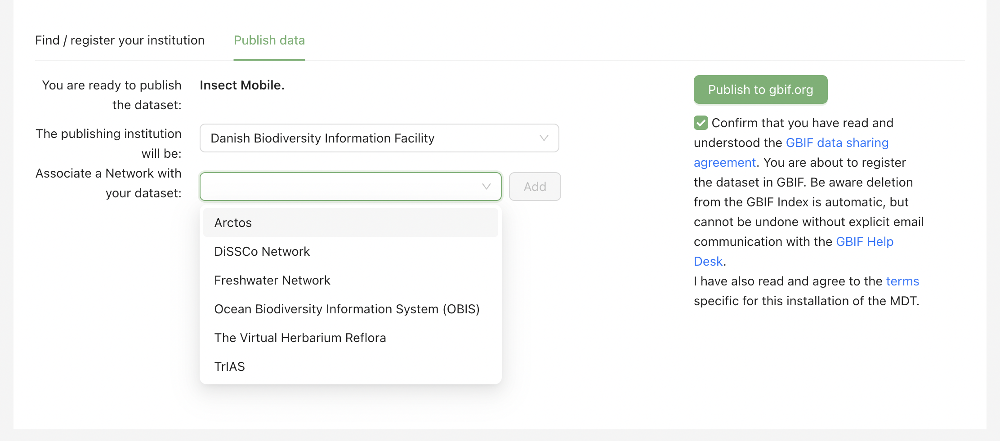
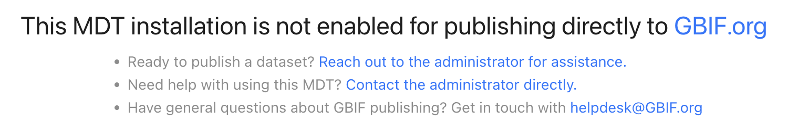

[[publish_update]]
== Publish and update

When you publish, your dataset gets its own page and DOI on GBIF.org, where anyone can find, use and cite it. What the *Publish* tab shows depends on your MDT installation: some installations let you publish directly, others only convert data and let the administrator publish for you.

[[publishing]]
=== Step 7: Publish your dataset on GBIF.org

.Why MDT installations differ
****
Each MDT installation is run by an administrator, usually a GBIF node (see <<mdt_installations>>), and the administrator decides how it works:

* *Publishing installations* publish datasets to GBIF.org directly, and GBIF hosts them. You can publish yourself once the administrator has given you access to publish under your institution.
* *Conversion-only installations* only create the Darwin Core Archive. The administrator publishes it for you, for example through the node's IPT, often because the data must be hosted on national servers.

So what you can do in step 7 depends on the installation you use, and in a publishing installation also on whether you have access to publish under an institution. For details, see <<admin_modes>>.
****

[[pub_pub]]
==== If you can publish directly from your MDT

The first time, you need access to publish under your institution:

. Under *Find / register your institution*, type your institution's name.
. If you find it, select it and click *Send email* (or *Copy email text*, to paste into your own email program) under "Ask for access to publish under this institution/organisation". Wait for the administrator's reply.
. If you cannot find it, click *Send email* (or *Copy email text*) under "Can´t find your institution/organisation?" and add the institution's name, address and a contact email. GBIF must approve your institution as a data publisher, which can take some time. You can start this before your dataset is ready (see <<what_you_need>>).

.Asking for access to publish under an institution

Until you have access, the *Publish data* tab says that you have not yet been affiliated with a GBIF publishing institution.

When you have access:

. Check the institution under *The publishing institution will be:*.
. Tick the box to confirm that you have read the GBIF data sharing agreement, and the installation's terms if they are shown.
. Click *Publish to gbif.org*, then *Dataset at gbif.org* to open your dataset page.
. Optional: after publishing, if your data should also reach a network such as OBIS, choose it under *Associate a Network with your dataset:* and click *Add*. To associate more than one network, repeat this for each network. Choosing OBIS tells OBIS to index your dataset. OBIS needs coordinates for every sample and works best with WoRMS identifiers (see <<obis_data>>).

NOTE: It takes from 15 minutes to an hour before the dataset page shows all occurrences.

.Ready to publish: the publishing institution, the data sharing agreement and the network

[[pub_con]]
==== If your MDT only converts data

The *Publish* tab says that the installation is not enabled for publishing directly to GBIF.org.

.The Publish step of an MDT that only converts data

. Under "Ready to publish a dataset?", click *Reach out to the administrator for assistance*. This emails the administrator of your MDT.
. The administrator checks your dataset and publishes it under a GBIF-approved publisher, usually your institution. This can take some time if your institution is not yet a GBIF publisher (see <<what_you_need>>).

You can also download the Darwin Core Archive in step 6 and publish it yourself, for example through an IPT (see <<faq_convert_only>>).

[[update]]
=== Update a published dataset

You can update a published dataset at any time; there is no time limit. Common reasons are corrected data, more samples, or a new paper based on the dataset (add it on the *Citations* tab in step 5).

. In *My datasets*, click the pen icon next to the dataset.
. Make your changes in the steps concerned, for example upload corrected files or edit the metadata. Keep the sample and OTU IDs the same as in the published version: the MDT builds each record's ID from them, so changed IDs make GBIF treat the records as new (see <<stable_ids>>).
. Create the archive again in step 6.
. In step 7, publish again (*Re-publish data*). The dataset keeps its page and DOI on GBIF.org.

GBIF.org always shows the latest version of a dataset, with the date of its last update. Earlier versions are not kept as separate versions. Data downloaded from GBIF.org gets its own DOI, so a study that used an earlier version can still cite exactly the data it used.

IMPORTANT: Do not delete a published dataset in the MDT: you can then no longer update it. Deleting only marks the dataset as deleted. To remove it completely, contact the GBIF Helpdesk (mailto:helpdesk@gbif.org[helpdesk@gbif.org]).

<<<
