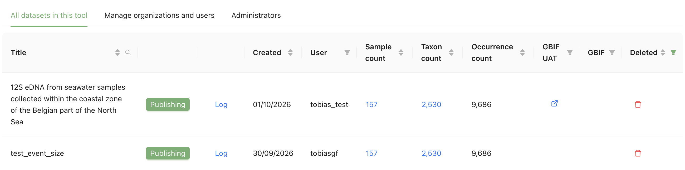
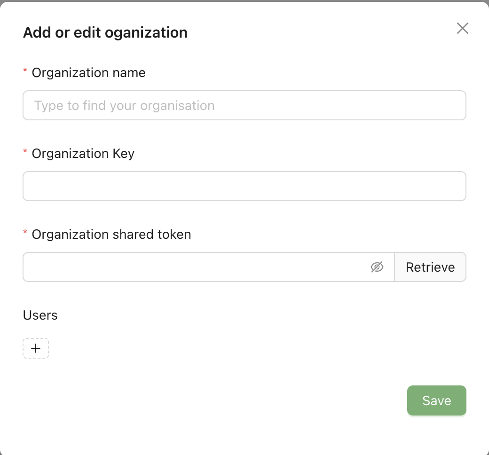

[[admin_menu]]
=== The administration pages

Only administrators see *Administration* in the menu bar. It has two tabs, *All datasets in this tool* and *Manage organizations and users*, plus a third, *Administrators*, for support administrators.

[[admin_datasets]]
==== All datasets in this tool

Lists every dataset in the installation, with its user, creation date, sample, taxon and occurrence counts, and links to the test (*GBIF UAT*) and published (*GBIF*) versions.

* Click a title to open the dataset at step 1, or click the sample or taxon count to view it.
* To publish a user's dataset yourself, click *Publishing* next to it. The button appears once the dataset has a Darwin Core Archive with occurrences, and opens step 7 of that dataset.
* *Log* opens the dataset's processing log. *Validation report* appears next to it if the dataset was checked by the GBIF data validator.
* To delete a dataset, click the bin icon and confirm. Datasets published on GBIF.org cannot be deleted.
* Sort and filter the list with the icons in the column headers: search titles, filter by *User*, show datasets that are *Published* or *Not published* on GBIF UAT or GBIF, or *Include deleted* datasets.

.The *All datasets in this tool* tab

[[man_org]]
==== Manage organizations and users

The table lists the organisations users can publish under, with their *Name*, *Key*, *Token* (shown as dots) and *Users*.

If publishing to GBIF.org is not enabled for the installation, a warning says so: you can add organisations and users, but they have no effect until `prodPublishingEnabled` is set in the configuration file (see <<admin_modes>>).

To let a user publish under an organisation that is already in the MDT:

. Find the organisation in the list.
. Under *Users*, click the plus sign and enter the user's GBIF username.

To add an organisation:

. Click *Add new organization*.
. Under *Organization name*, type the name and select the organisation. Only organisations already registered with GBIF can be added. The *Organization Key* is filled in automatically.
. Next to *Organization shared token*, click *Retrieve*. This works if you have the rights in the GBIF Registry. If not, the MDT shows a link to an email to the mailto:helpdesk@gbif.org[GBIF Helpdesk] asking for the token. Without the token, nobody can publish under the organisation.
. Optional: add users under *Users*.
. Click *Save*.

To change an organisation, click the pen icon next to it. To remove it, click the bin icon.

Removing an organisation removes it from the MDT only, not from the GBIF Registry.

.Adding an organisation

[[admin_admins]]
==== Administrators

Only support administrators see this tab. It shows the *Installation contact* and the user names of the *Installation administrators* and *Support administrators*. The page is read-only: these are set in the installation's configuration.
